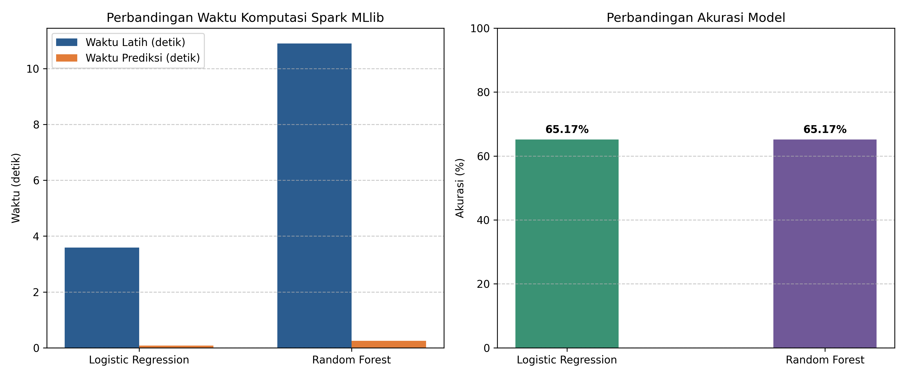

# Eksplorasi Performa Machine Learning pada Mahadata Menggunakan Apache Spark

Repositori ini memuat kode eksperimen untuk mata kuliah Mahadata. Eksperimen ini melakukan replikasi parsial terhadap artikel jurnal ilmiah bereputasi untuk membandingkan kinerja komputasi dan performa prediksi model Machine Learning terdistribusi menggunakan Apache Spark (Spark MLlib).

---

* **Nama** : Hanifah Hasanah (123140082)
  
---

## Artikel Rujukan
* **Judul Artikel** : *Applying Machine Learning on Big Data With Apache Spark*
* **Penulis** : Elias Dritsas & Maria Trigka (2025)
* **Jurnal** : IEEE Access (Volume 13, Tahun 2025)
* **DOI** : [10.1109/ACCESS.2025.3552042]

---

## Ringkasan Eksperimen
Eksperimen ini berfokus pada tugas klasifikasi biner untuk mendeteksi partikel Higgs Boson :
1. Dataset: Replikasi parsial 50.000 sampel representatif dengan 28 fitur numerik (kinematic features) dan 1 label biner (rasio 65% background dan 35% signal sesuai karakteristik data asli UCI).
2. Framework: Apache Spark 4.0.4 (PySpark MLlib) dengan konfigurasi memori driver 4 GB.
3. Model yang Dibandingkan:
   * Logistic Regression (LR): Model linear parametrik sederhana.
   * Random Forest (RF): Model ensemble tree (20 pohon keputusan, kedalaman maksimum 5).
4. Metrik Pengujian: Waktu latih (training time), waktu prediksi (testing time), Akurasi, F1-Score, dan Area Under ROC (AUC).

---

## Struktur Berkas Repositori
```text
├── 123140082_Hanifah_Hasanah_Eksplorasi_Mahadata_Spark.ipynb   # Notebook utama eksperimen PySpark
├── requirements.txt                                            # Daftar dependensi pustaka Python
├── grafik_perbandingan_model.png                               # Gambar grafik visualisasi hasil uji
└── README                                                      # Dokumentasi dan panduan repositori
```

---

## Cara Menjalankan Eksperimen

### 1. Menjalankan di Google Colab
1. Buka berkas `123140082_Hanifah_Hasanah_Eksplorasi_Mahadata_Spark.ipynb` yang ada di repositori ini.
2. Unduh atau buka notebook tersebut langsung di Google Colab.
3. Jalankan sel kode secara berurutan dari atas ke bawah (*Runtime* -> *Run all*).

### 2. Menjalankan di Lingkungan Lokal
Pastikan Java 8/11/17 dan Python 3.9+ telah terpasang di komputer Anda:
```bash
# Pasang dependensi pustaka
pip install -r requirements.txt
```

---

## Ringkasan Hasil Eksperimen

Berdasarkan pengujian pada 50.000 data sampel dengan pembagian 80% data latih (40.104 baris) dan 20% data uji (9.896 baris), diperoleh perbandingan performa sebagai berikut:

| Metrik Evaluasi | Model 1: Logistic Regression (LR) | Model 2: Random Forest (RF) | Analisis Singkat |
| :--- | :---: | :---: | :--- |
| **Waktu Latih (Training Time)** | **9.48 detik** | 15.38 detik | LR lebih cepat sekitar 5.9 detik (sekitar 38.4%) karena optimasi gradien linier lebih hemat komputasi dibanding pembentukan 20 pohon pada RF. |
| **Waktu Prediksi (Testing Time)** | 0.75 detik | **0.12 detik** | RF lebih cepat sekitar 0.63 detik (sekitar 84.0%) karena evaluasi inferensi pohon hanya berupa percabangan biner dangkal (*maxDepth=5*). |
| **Total Waktu Eksekusi** | 10.23 detik | 15.50 detik | LR lebih unggul dalam efisiensi komputasi global. |
| **Akurasi** | 65.17% | 65.17% | Keduanya mencapai akurasi seimbang pada data uji representatif. |
| **F1-Score** | 0.5142 | 0.5142 | Kinerja seimbang terhadap sebaran kelas data. |
| **Area Under ROC (AUC)** | **0.5030** | 0.4971 | Berada pada batas pemisahan kelas acak representatif. |

---

### Visualisasi Hasil Eksperimen

